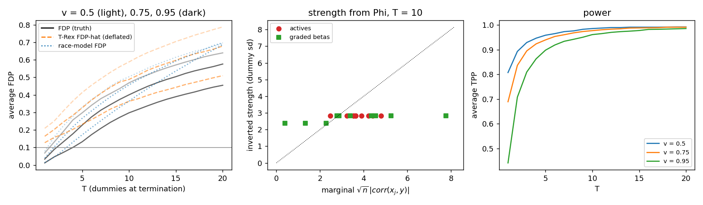

# T-Rex variable selection as a race against reference runners (#1030)

Machkour, Muma and Palomar, "The terminating-random experiments selector",
*Signal Processing* 231 (2025). Their setup throughout: n = 300, p = 1000,
p1 = 10 actives with beta = 1, Gaussian predictors, SNR = 1 (noise variance
set to Var(X beta)), K = 20 random experiments, L = p standard-normal
dummies, LARS paths (`sklearn.linear_model.lars_path`, method `lar`),
termination when T dummies have entered. Target FDR 0.1. Scripts:
`run_trex_race.py` (the race reading, Fig. 5 grid, calibrated selection),
`run_trex_extensions.py` (A, B, C below), `summarise.py` (the tables),
`plot_trex_race.py`. Results in `results_L1p_MC200.json` and
`results_extensions_MC50.json`. sklearn is not in CI; nothing here is a
test. The deflation (their Definition 5) and FDP estimator follow the R
package `TRexSelector` (`Phi_prime_fun`, `fdp_hat`), including the cap at
one and the selected set A = {Phi_T > 0.5} fixed at the stopping T.

## The race reading, corrected on the way

The issue's premise was: the forward-selection path is a race, the dummies
are identical reference runners, and a variable's relative occurrence
Phi_{T,L}(j) = P(j enters before the T-th dummy) is a top-k membership
probability against an identical field. Two things had to be put right
before the numbers made sense.

1. **T-Rex randomises the field, not the runner.** A real column's
   statistic (its absolute correlation with the current residual) is fixed
   by the data; only the dummies are redrawn between experiments. A real
   variable is therefore a runner of fixed strength s with no fresh
   performance noise, and the dummy field is L i.i.d. half-normal runners
   (|N(0, 1)| in units of the dummy sampling sd; entry is by |correlation|).
   So P_T(s) = P(Binomial(L, P(|Z| > s)) <= T - 1), a closed form on the
   identical field. Given the data the K inclusion indicators are i.i.d.
   Bernoulli, so Phi_{T,L}(j) ~ Binomial(K, q_j) / K exactly; the race
   model is the approximation q_j = P_T(s_j). It is an approximation
   because a candidate's statistic is its correlation with the current
   residual, which moves with the variables and the up-to-T-1 dummies
   already on the path, and LARS enters by that rather than by the
   marginal correlation. The null-count check below measures how good it
   is.
   The first version used winning's `top_k_probabilities` with the runner
   at unit noise; it predicted 131 nulls with Phi_1 > 0 where one was
   observed. The general engine can represent the noiseless runner only
   as the limit D_j -> 0, which the lattice resolves slowly (table below);
   the closed form is used and the engine is reported against it.
2. **The deflation is subtler than the paper's display suggests.** In the
   R package the set A over which the step increments are summed is the
   final selected set at the stopping T, not the set at each step; my first
   reading gave negative scales and estimates above one. The package's
   form is implemented and used throughout.

The nulls are exchangeable with the dummies, so their strengths follow the
dummy law s ~ |N(0, 1)|. Integrating the selection event over that law gives
a race-model estimate of the number of selected nulls, the twin of the
paper's deflated V-hat; it needs no deflation because interspersion is in
the model.

### Engine against the closed form (noiseless runner, identical field)

| T | s | D_j | points | engine | closed form |
|---|---|---|---|---|---|
| 1 | 3.0 | 0.04 | 513 | 0.1155 | 0.0670 |
| 1 | 3.0 | 0.01 | 1025 | 0.0814 | 0.0670 |
| 5 | 3.0 | 0.04 | 513 | 0.7553 | 0.8632 |
| 5 | 3.0 | 0.01 | 1025 | 0.8258 | 0.8632 |
| 20 | 2.0 | 0.04 | 513 | 0.0450 | 0.0000 |
| 20 | 2.0 | 0.01 | 1025 | 0.0027 | 0.0000 |

### One data set: the race law for the nulls (predicted / observed number of nulls with Phi_T > v)

| T | v = 0 | v = 0.25 | v = 0.5 | v = 0.75 | null strength mean, sd | Phi = 0 nulls (floored) |
|---|---|---|---|---|---|---|
| 1 | 3.5 / 1 | 1.3 / 1 | 0.6 / 1 | 0.3 / 0 | 2.90, 0.02 | 989 |
| 5 | 9.7 / 9 | 5.9 / 1 | 4.4 / 1 | 3.2 / 1 | 2.56, 0.02 | 981 |
| 10 | 16.2 / 16 | 11.3 / 9 | 9.2 / 4 | 7.4 / 2 | 2.38, 0.03 | 974 |
| 20 | 28.2 / 41 | 21.7 / 22 | 18.9 / 20 | 16.1 / 13 | 2.17, 0.04 | 949 |

### One data set: actives (T = 1)

| active | Phi_1 | strength on the dummy scale | marginal sqrt(n)|corr| |
|---|---|---|---|
| 1 | 0.40 | 3.32 | 3.53 |
| 2 | 0.05 | 3.01 | 2.47 |
| 3 | 0.50 | 3.39 | 3.23 |
| 4 | 0.70 | 3.56 | 3.64 |
| 5 | 0.75 | 3.61 | 3.63 |
| 6 | 1.00 | 4.22 | 4.23 |
| 7 | 0.70 | 3.56 | 3.53 |
| 8 | 0.90 | 3.83 | 3.90 |
| 9 | 1.00 | 4.22 | 4.80 |
| 10 | 1.00 | 4.22 | 4.41 |

Spearman(strength, |beta|) over all p at T = 1: 0.953; Spearman(strength, marginal t) among nulls: 0.055.

Graded betas, T = 5: beta [0.25, 0.25, 0.5, 0.5, 0.75, 0.75, 1.0, 1.0, 1.25, 1.25]; Phi [0.0, 0.0, 0.0, 1.0, 1.0, 1.0, 1.0, 1.0, 1.0, 1.0]; strength [2.56, 2.56, 2.56, 3.16, 3.16, 3.16, 3.16, 3.16, 3.16, 3.16]; Spearman(strength, beta) = 0.77, Spearman(marginal t, beta) = 0.91.

Graded betas, T = 10: beta [0.25, 0.25, 0.5, 0.5, 0.75, 0.75, 1.0, 1.0, 1.25, 1.25]; Phi [0.0, 0.0, 0.0, 1.0, 1.0, 1.0, 1.0, 1.0, 1.0, 1.0]; strength [2.38, 2.38, 2.38, 2.83, 2.83, 2.83, 2.83, 2.83, 2.83, 2.83]; Spearman(strength, beta) = 0.77, Spearman(marginal t, beta) = 0.91.

### Fig. 5 grid, L = p, MC = 200: average FDP / T-Rex FDP-hat / race-model FDP, and TPP

| T | v = 0.5 FDP / hat / model / TPP | v = 0.75 FDP / hat / model / TPP | v = 0.95 FDP / hat / model / TPP |
|---|---|---|---|
| 1 | 0.068 / 0.209 / 0.078 / 0.81 | 0.034 / 0.164 / 0.040 / 0.69 | 0.012 / 0.127 / 0.014 / 0.44 |
| 2 | 0.131 / 0.250 / 0.158 / 0.89 | 0.088 / 0.202 / 0.101 / 0.84 | 0.046 / 0.157 / 0.044 / 0.71 |
| 5 | 0.298 / 0.414 / 0.330 / 0.96 | 0.228 / 0.326 / 0.267 / 0.94 | 0.133 / 0.232 / 0.172 / 0.90 |
| 10 | 0.469 / 0.588 / 0.503 / 0.99 | 0.400 / 0.488 / 0.457 / 0.98 | 0.298 / 0.363 / 0.364 / 0.96 |
| 20 | 0.640 / 0.788 / 0.693 / 0.99 | 0.576 / 0.679 / 0.697 / 0.99 | 0.455 / 0.510 / 0.687 / 0.99 |

### Calibrated at alpha = 0.1 (Algorithm 1 at L = p), MC = 200

| estimator in the calibration | FDR | TPR | mean selected | median T* | median v* |
|---|---|---|---|---|---|
| trex | 0.002 ± 0.001 | 0.052 ± 0.013 | 0.5 | 1 | 0.95 |
| model | 0.096 ± 0.007 | 0.847 ± 0.009 | 9.5 | 3 | 0.95 |

### What held and what did not, in the base setting

- The race law for the nulls is approximately right where it can be
  checked on one data set (number of nulls with Phi_T > v, predicted
  against observed, table above): right at the extremes, over-predicting
  nulls at Phi >= 0.5 for T = 5 to 10 by a factor of two to four (counts of
  one to four, so noisy), under-predicting at v = 0 for T = 20 (28 vs 41).
- Phi is too coarse for a strength scale at K = 20: it saturates at 0 or 1
  for nearly every variable (Phi = 0 for 95 to 99 percent of nulls, Phi = 1
  for the actives beyond T = 5), and a saturated Phi inverts to the floor
  or ceiling of the smoothed estimate ((K Phi + 1/2) / (K + 1)), not to a
  strength. The null "strength" column above is that floor. The graded-beta
  check (beta in 0.25 to 1.25) gives Phi = 0 for the three weakest actives
  and 1 for the rest, so the strength is two-valued and its rank
  correlation with beta (0.77) is the tie structure, not a calibration.
  The marginal statistic sqrt(n)|corr| correlates 0.91 with beta on the
  same actives. The position-aware statistic of A is the fix.
- At L = p the published estimator is so conservative that Algorithm 1
  selects almost nothing (table: FDR 0.002, TPR 0.05). The paper's power
  figures come from Algorithm 2, which raises L to 10p until the estimate
  at (T = 1, v = 0.75) falls below the target; that was not run here, so
  the TPR is not comparable with their Table 1. The Fig. 5 grid at L = p
  is comparable: our realised FDP and TPP surfaces have the shape of
  theirs, and their FDP-hat is conservative everywhere, most at small T.
- The race-model estimate in the same Algorithm 1 at L = p calibrates at
  the target (FDR 0.096 ± 0.007) with power 0.85 (table). It is an
  estimate under a model, not a guarantee: on the grid it tracks the
  realised FDP to within 0.01 at T = 1 and within 0.03 at T = 2,
  over-estimates by 0.03 to 0.07 at T = 5 to 10 and by 0.23 at T = 20,
  v = 0.95, so Algorithm 1 lands
  on T* = 3 (median) where the estimate is about right. Section C shows
  the same estimate is anti-conservative on sets chosen by other
  statistics.

## A. Position-aware statistic: AUC actives vs nulls (MC = 50)

| design | T | AUC(Phi) | AUC(position posterior) | paired difference |
|---|---|---|---|---|
| independent | 5 | 0.984 ± 0.003 | 0.984 ± 0.003 | 0.0005 ± 0.0001 |
| independent | 10 | 0.993 ± 0.002 | 0.995 ± 0.002 | 0.0017 ± 0.0001 |
| independent | 20 | 0.993 ± 0.001 | 0.997 ± 0.001 | 0.0037 ± 0.0002 |
| ar1 | 5 | 0.993 ± 0.002 | 0.994 ± 0.002 | 0.0007 ± 0.0001 |
| ar1 | 10 | 0.993 ± 0.002 | 0.995 ± 0.002 | 0.0018 ± 0.0002 |
| ar1 | 20 | 0.994 ± 0.001 | 0.998 ± 0.001 | 0.0034 ± 0.0002 |
| clustered | 5 | 0.957 ± 0.007 | 0.958 ± 0.007 | 0.0006 ± 0.0001 |
| clustered | 10 | 0.967 ± 0.005 | 0.969 ± 0.005 | 0.0013 ± 0.0001 |
| clustered | 20 | 0.973 ± 0.005 | 0.975 ± 0.005 | 0.0023 ± 0.0002 |

## B. Realised FDR and TPR at target 0.1

| design | method | FDR | TPR | mean selected | share empty |
|---|---|---|---|---|---|
| independent | (i) T-Rex as published (Alg. 1, L = p) | 0.012 ± 0.010 | 0.020 ± 0.016 | 0.3 | 0.96 |
| independent | (ii) ranked by position posterior, sized by V-hat | 0.009 ± 0.007 | 0.062 ± 0.026 | 0.7 | 0.88 |
| independent | (ii-m) same ranking, sized by the race-model estimate | 0.177 ± 0.018 | 0.886 ± 0.016 | 11.1 | 0.00 |
| independent | (i) mapped to block level | 0.012 ± 0.010 | 0.020 ± 0.016 | 0.3 | 0.96 |
| independent | (iii) block statistic, block level, sized by block V-hat | 0.714 ± 0.005 | 0.978 ± 0.006 | 34.6 | 0.00 |
| independent | (iii-m) block statistic, sized by the race-model estimate | 0.221 ± 0.020 | 0.908 ± 0.012 | 12.1 | 0.00 |
| ar1 | (i) T-Rex as published (Alg. 1, L = p) | 0.006 ± 0.004 | 0.140 ± 0.040 | 1.5 | 0.76 |
| ar1 | (ii) ranked by position posterior, sized by V-hat | 0.036 ± 0.012 | 0.250 ± 0.048 | 2.8 | 0.60 |
| ar1 | (ii-m) same ranking, sized by the race-model estimate | 0.243 ± 0.021 | 0.934 ± 0.011 | 12.8 | 0.00 |
| ar1 | (i) mapped to block level | 0.005 ± 0.003 | 0.138 ± 0.039 | 1.4 | 0.76 |
| ar1 | (iii) block statistic, block level, sized by block V-hat | 0.684 ± 0.007 | 0.980 ± 0.006 | 31.7 | 0.00 |
| ar1 | (iii-m) block statistic, sized by the race-model estimate | 0.234 ± 0.020 | 0.930 ± 0.014 | 12.6 | 0.00 |
| clustered | (i) T-Rex as published (Alg. 1, L = p) | 0.182 ± 0.031 | 0.294 ± 0.049 | 4.8 | 0.50 |
| clustered | (ii) ranked by position posterior, sized by V-hat | 0.229 ± 0.029 | 0.454 ± 0.047 | 7.2 | 0.30 |
| clustered | (ii-m) same ranking, sized by the race-model estimate | 0.429 ± 0.015 | 0.860 ± 0.017 | 15.5 | 0.00 |
| clustered | (i) mapped to block level | 0.014 ± 0.005 | 0.340 ± 0.055 | 3.5 | 0.50 |
| clustered | (iii) block statistic, block level, sized by block V-hat | 0.601 ± 0.007 | 0.998 ± 0.002 | 25.4 | 0.00 |
| clustered | (iii-m) block statistic, sized by the race-model estimate | 0.218 ± 0.017 | 0.974 ± 0.007 | 12.8 | 0.00 |

## C. Calibration of the estimators on the sets (ii) and (iii) select

| design | selection | n | realised FDP | V-hat / R | race-model | FDP - V-hat | FDP - model |
|---|---|---|---|---|---|---|---|
| independent | position | 6 | 0.072 ± 0.055 | 0.099 ± 0.000 | 0.037 ± 0.014 | -0.027 ± 0.055 | 0.035 ± 0.060 |
| independent | position_model | 50 | 0.177 ± 0.018 | 0.273 ± 0.010 | 0.071 ± 0.003 | -0.095 ± 0.017 | 0.106 ± 0.017 |
| independent | block | 50 | 0.714 ± 0.005 | 0.097 ± 0.000 | 0.699 ± 0.014 | 0.617 ± 0.005 | 0.015 ± 0.018 |
| independent | block_model | 50 | 0.221 ± 0.020 | 0.085 ± 0.017 | 0.060 ± 0.004 | 0.135 ± 0.022 | 0.160 ± 0.018 |
| ar1 | position | 20 | 0.091 ± 0.027 | 0.098 ± 0.001 | 0.013 ± 0.004 | -0.007 ± 0.027 | 0.078 ± 0.027 |
| ar1 | position_model | 50 | 0.243 ± 0.021 | 0.261 ± 0.010 | 0.076 ± 0.003 | -0.018 ± 0.020 | 0.167 ± 0.021 |
| ar1 | block | 50 | 0.684 ± 0.007 | 0.097 ± 0.000 | 0.702 ± 0.018 | 0.587 ± 0.007 | -0.018 ± 0.024 |
| ar1 | block_model | 50 | 0.234 ± 0.020 | 0.096 ± 0.017 | 0.059 ± 0.005 | 0.137 ± 0.024 | 0.174 ± 0.018 |
| clustered | position | 35 | 0.328 ± 0.028 | 0.097 ± 0.001 | 0.036 ± 0.008 | 0.231 ± 0.028 | 0.292 ± 0.031 |
| clustered | position_model | 50 | 0.429 ± 0.015 | 0.269 ± 0.011 | 0.081 ± 0.003 | 0.160 ± 0.019 | 0.348 ± 0.014 |
| clustered | block | 50 | 0.601 ± 0.007 | 0.097 ± 0.000 | 0.552 ± 0.013 | 0.504 ± 0.007 | 0.049 ± 0.018 |
| clustered | block_model | 50 | 0.218 ± 0.017 | 0.129 ± 0.016 | 0.066 ± 0.004 | 0.089 ± 0.021 | 0.152 ± 0.017 |

### Verdicts

- **A.** The position-aware posterior is not a monotone transform of Phi
  (the paired AUC differences are positive in every design and every T,
  +0.0005 to +0.0037 with SE <= 0.0002), but the information beyond
  inclusion is a sliver: Phi already separates actives from nulls at AUC
  0.96 to 0.99, and the positions add at most 0.4 AUC points.
- **B.** At L = p with Algorithm 1 the published T-Rex has almost no
  power (TPR 0.02, 0.14, 0.29) and in the clustered design its realised
  FDR is 0.18, above the target; ranking by the position posterior and
  sizing by V-hat adds 4 to 16 points of TPR at FDR 0.01 to 0.04 in the
  independent and AR(1) designs and 0.23 in the clustered one. Sizing by
  the race-model estimate buys power (TPR 0.86 to 0.97) at FDR 0.18 to
  0.43: not controlled. At block level the block statistic sized by a
  block V-hat is useless (FDR 0.60 to 0.71); sized by the race model it
  reaches TPR 0.93 to 0.97 at FDR 0.22, against FDR 0.01 and TPR 0.34 for
  the published selection mapped to blocks in the clustered design.
  Nothing here both controls FDR at 0.1 and has power at L = p; the
  paper's remedy for that is more dummies (Algorithm 2), not run.
- **C.** V-hat on the sets the position ranking selects: the column n in
  the table is the number of the 50 runs in which that selection was
  non-empty, and the SEs are over those runs only. In the independent
  design the selection was empty in 44 of 50 runs, so FDP - V-hat =
  -0.03 ± 0.06 rests on 6 runs and says little; in AR(1) (n = 20) it is
  -0.01 ± 0.03, consistent with calibration; in the clustered design
  (n = 35) it is +0.23 ± 0.03, calibration lost. There is no proof behind
  it in any of them. On block-level sets it is far off
  (+0.5 to +0.6): a null block's "any member entered" occurrence is
  inflated by its five members and the paper defines no block deflation.
  The race-model estimate is calibrated for Phi-threshold selection in the
  base setting and for the block sets V-hat sized (within ± 0.05), but
  anti-conservative on the sets its own sizing picks (realised FDP above
  the estimate by 0.10 to 0.35 in every design): selecting on the model's
  own statistic finds exactly the nulls for which the |N(0, 1)| dummy law
  is optimistic. The model-based alternative is a diagnostic here, not a
  calibration tool.

### Denominators and n

Block-level TPP in the committed `results_extensions_MC50.json` divides
by p1 = 10. In the clustered design the actives are one per block, so that
is the number of active blocks; in the independent and AR(1) designs two
actives can share a block (about 9.8 distinct active blocks on average),
so the committed block TPPs there are under-stated by up to about 2
percent and a perfect block selector tops out near 0.98, which is the
value the (iii) row shows. The script now divides by the number of active
blocks; the JSON was not regenerated. The n column of the C table counts
the runs with a non-empty selection; every SE there is over those runs.

Three further changes to the scripts after review, none of which changes
a committed number by more than the stated amount, and none re-run:

- The race-model null count in the base grid and calibration now uses
  p0 = p - p1 (the simulation's null count, as the detail check and the
  extensions already did) instead of p. The committed `fdp_model` column
  and the "model" calibration row used p and are 1 percent more
  conservative than the script now computes.
- The block-model sizing and reporting use the number of null blocks,
  nb minus the number of active blocks, instead of nb - p1; identical in
  the clustered design, and 0.1 percent off in the others.
- Arm A evaluated every T in {5, 10, 20} regardless of how many dummies
  a repetition's paths reached; it now skips T above that repetition's
  T_max and reports n per T. No committed cell was affected: T_max is
  min(30, dummies reached), and the paths reach far more than 30 dummies
  in 298 LARS steps. Replaying the committed base seed, the per-repetition
  minimum over the 20 paths was 96 to 110 dummies in the first 20
  repetitions; a clustered-design check reached 131 to 139. New runs
  record the range in `dmin_over_reps`.

Every repetition is now appended to a JSONL log as it completes
(`log_*.jsonl`, one line per repetition, flushed) and the summaries are
built from the log; result files are written atomically, never over an
existing file (a stamped, pid-suffixed name claimed exclusively), and the
extensions file is rewritten after every design.

### Not done

- Algorithm 2 (L up to 10p) and L = 3p, 5p of Fig. 5: cost (LARS on
  n x (p + L) at every experiment).
- The block statistic uses the design correlation only for the synthetic
  null blocks (the law of a null block's strengths). The runners are
  noiseless, so there is no performance noise for a factor loading V to
  act on; the directive's "V from the block structure" has nothing to
  attach to in this model.
- Only the paper's fixed-T calibration search is used for (ii) and (iii),
  over the T values listed in `T_MODEL` for the model-sized arms (cost).
